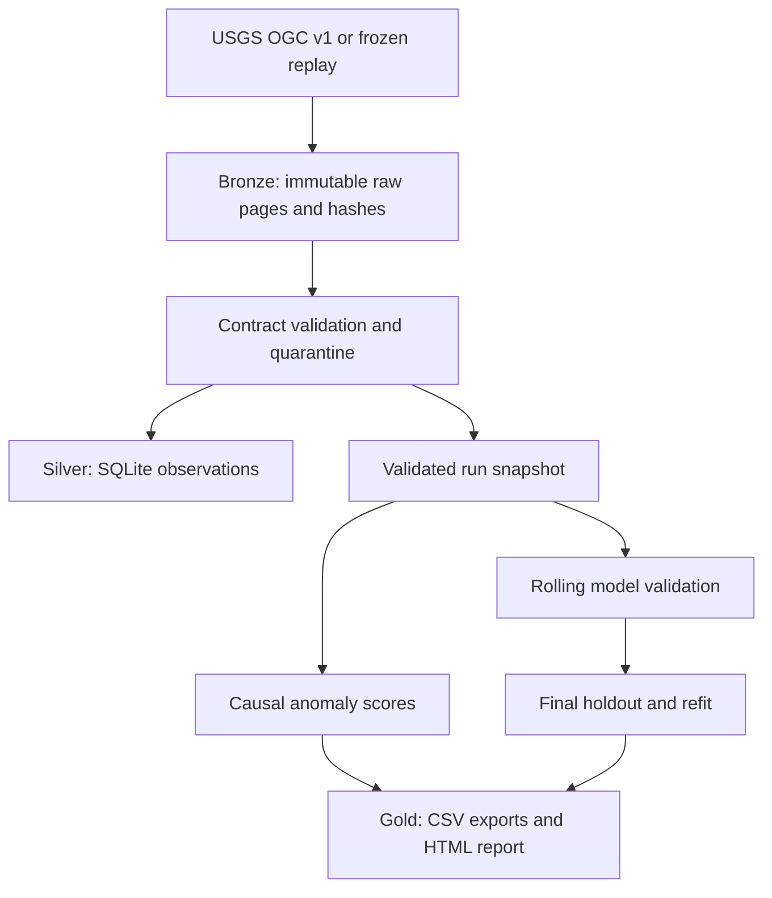

# Groundwater Intelligence & Forecasting Platform

A Python starter for a public-data monitoring project with emphasis on **data engineering,
time-series evaluation, and scientific reproducibility**. It ingests real USGS groundwater
measurements, validates them, flags unusual observations, and compares forecasts against
simple baselines. Each run produces an HTML report and auditable data exports.

This is a working foundation to extend, not a deployed service or a finished hydrological model.

## Start here

Use **Python 3.11 or newer** (3.12 recommended). Extract this folder, open a terminal in it,
and install the package. The first installation needs internet access for dependencies.

**Windows PowerShell** — activation is not required:

```powershell
py -3.12 -m venv .venv
.\.venv\Scripts\python.exe -m pip install -e .
.\.venv\Scripts\groundwater.exe replay --file examples/usgs_daily_2023_2024.geojson
```

**macOS / Linux:**

```bash
python3 -m venv .venv
source .venv/bin/activate
python -m pip install -e .
groundwater replay --file examples/usgs_daily_2023_2024.geojson
```

The program prints a path ending in `report.html`. Open it in your browser. No dashboard
server, cloud account, API key, or database server is required for this replay.
On Windows, use `.\.venv\Scripts\groundwater.exe` in place of `groundwater` below if you have
not activated the environment. Use `.\.venv\Scripts\python.exe` in place of `python` likewise.

The included snapshot contains **731 actual USGS daily measurements from 2023–2024**,
for `USGS-444302070252401`, the groundwater well used in the USGS API documentation.
`examples/SOURCE.json` records its URL, retrieval time, and SHA-256 hash. This is historical
data: the forecast after this snapshot starts in January 2025, not the present day.

## What you can run

```bash
# Reproduce the bundled real-data analysis offline after installing dependencies
groundwater replay --file examples/usgs_daily_2023_2024.geojson --config configs/default.toml

# Fetch the same historical range directly from USGS, then run the full analysis
groundwater run --config configs/default.toml --root artifacts/live

# Generated seasonal data with an injected spike; explicitly labeled synthetic
groundwater demo --root artifacts/demo

# Find candidate daily groundwater wells in the broader Portland region
groundwater discover --bbox=-123.2,45.1,-122.1,46.0

# Offline unit tests
python -m unittest discover -s tests -v
```

`discover` returns monitoring identifiers, series IDs, latest dates, and coordinates, saving
`artifacts/discovery.json`. A candidate is not guaranteed to have enough dense historical data.
An empty result means widen the box or choose another region. Copy the chosen identifier into
a new TOML config, adjust `start` and `end`, and use `--config configs/your_well.toml`.
For current monitoring, set `end` to a recent completed date and retain several years of history.
Keep dates and identifiers quoted in TOML so they remain strings.

Optional API key: obtain a free key at <https://api.waterdata.usgs.gov/signup> and set it in
your environment. This is sent in a request header, not saved in the manifest:

```powershell
# PowerShell
$env:USGS_API_KEY = "your-key"
```

```bash
# macOS / Linux
export USGS_API_KEY="your-key"
```

`.env.example` documents the variable; `.env` files are not loaded automatically. API requests
can work without a key at a lower rate limit. Failed network requests never switch to synthetic
data automatically. Rerun the command if rate limited after retries.

## Scientific scope

The starter intentionally supports **one variable and statistic**:

| Field | Meaning |
|---|---|
| Parameter `72019` | Groundwater depth below land surface, feet |
| Statistic `00003` | Daily mean |
| Increasing depth | Water is farther below the land surface |
| Negative depth | May indicate water above land surface; not automatically invalid |

Do not mix this with groundwater elevation above a vertical datum, stream gage height, or
other statistics. One well does not establish conditions throughout an aquifer. Anomaly
flags do not establish drought, contamination, or sensor failure.

## Data engineering design



- **Ingestion:** follows the server's next-page links; retries transient HTTP errors with
  backoff; enforces timeouts and a maximum page count. Truncated or malformed responses fail.
- **Raw preservation:** source pages are content addressed with SHA-256; unchanged pages reuse
  the same file. Each run has a separate provenance manifest and frozen config.
- **Data contract:** validates site, series, calendar date, variable, statistic, units,
  finite values, and source revision timestamps. Invalid records go to quarantine.
- **Identity and revisions:** SQLite uses a compound natural key and revision-aware upserts.
  Repeat ingestion does not add duplicate observation rows. Different series are not averaged.
- **Snapshot isolation:** models use this run's validated CSV, not whatever happens to be in
  the mutable SQLite table. A failed or quarantined source value cannot be silently substituted
  from an older database run. Raw pages remain available to audit source changes.
- **Quality gates:** internal calendar gaps and coverage are measured before forecasting;
  excessive gaps stop the forecast. Leading/trailing requested-window gaps and age are reported.
- **Run isolation:** synthetic and real ingestion use separate database files and bronze paths.
  Reports clearly distinguish live, replay, and generated data.
- **Failure visibility:** failure manifests retain the error; the CLI returns a nonzero status.
  No API keys are committed. Tests mock network calls; GitHub Actions runs checks on pushes/PRs.

## Data science design

| Model | Role |
|---|---|
| Persistence | Last observed depth repeated; a serious short-horizon baseline |
| Seasonal naive | Value 365 calendar days earlier, recursively repeated if needed |
| Ridge with lag features | Regularized autoregression with calendar seasonality |
| Random forest with lag features | Nonlinear comparison with fixed hyperparameters and seed |

Lag models use lags 1/7/14/30, preceding 7/30-day means, preceding 7-day standard deviation,
and annual sine/cosine features. Training targets are measured values. Only predictors may
use bounded forward filling. Scaling and model fitting happen independently inside each fold.

The last forecast horizon is held out. Model selection uses earlier, nonoverlapping forecast
windows with expanding training histories, ranked by pooled **MAE in feet**. RMSE and signed
bias are also exported. The selected model is scored on the final holdout and refit on all
available data to forecast the next horizon. All multiday forecasts are recursive; future
actual values are not fed into lag features. Missing observed targets are never imputed for
scoring. There are no calibrated prediction intervals yet.

The anomaly detector compares each value against the **preceding** 60 calendar days using a
median/MAD score, with a configurable scale floor in feet. It reports warm-up and unscorable
days separately and retains flagged measurements in training. Labels and thresholds need
domain review before using these flags as an operational alert.

Read [docs/METHODOLOGY.md](docs/METHODOLOGY.md) for assumptions and limitations.

## Files and outputs

```text
src/groundwater/
  usgs.py          API client, pagination, retries, raw archive
  quality.py       Measurement contract, quarantine, gap/coverage checks
  storage.py       SQLite schema and revision-aware upsert
  anomalies.py     Causal robust anomaly detector
  forecast.py      Lag features, four models, validation, final holdout
  pipeline.py      Reproducible run orchestration and provenance
  report.py        Self-contained HTML report and inline chart
  cli.py           Commands and configuration
configs/           TOML settings
examples/          Frozen real government data and source manifest
tests/             Offline correctness and leakage tests
docs/              Methodology, roadmap, and starter validation results
```

Every successful run creates:

| Output | Purpose |
|---|---|
| `report.html` | Portable visual report |
| `observations.csv` | The exact validated analysis snapshot |
| `quality.json`, `quarantine.json` | Coverage, missingness, quality flags, rejected data |
| `anomalies.csv` | Scores, flags, causal reference statistics |
| `leaderboard.csv`, `folds.csv` | Model ranking and fold-level metrics |
| `validation_predictions.csv` | Auditable actual/predicted pairs and lead days |
| `holdout.json`, `holdout_predictions.csv` | Separate final evaluation |
| `forecast.csv` | Next-horizon predictions from the refitted selected model |
| `config.json`, `provenance.json` | Settings, timestamps, source hashes, code hash, package versions |

Outputs live under `artifacts/runs/<unique-run-id>/`. Bronze JSON and silver SQLite are adjacent
under `artifacts/`. Output folders are ignored by git; commit code and small public fixtures.
`sample_output/` contains a checked example report and exports from the bundled real snapshot.

## Build it into your portfolio

Start by reproducing the bundled run, explaining why a persistence baseline can be hard to
beat, and interpreting validation versus holdout errors. Then add an Oregon well and compare
the results without changing the experiment rules after seeing the holdout.

The highest-value next steps are in [docs/ROADMAP.md](docs/ROADMAP.md): incremental ingestion,
precipitation/recharge features, longer seasonal evaluation, calibrated uncertainty, and a
multi-well operations dashboard. This starter emphasizes correct data and evaluation before
adding infrastructure. Keep your eventual README precise about what you personally implemented,
what was measured, and what remains experimental.

## Sources

- [USGS OGC API documentation](https://api.waterdata.usgs.gov/docs/ogcapi/)
- [USGS API migration guide](https://api.waterdata.usgs.gov/docs/ogcapi/migration/)
- [USGS API keys](https://api.waterdata.usgs.gov/docs/ogcapi/keys/)
- [USGS daily collection](https://api.waterdata.usgs.gov/ogcapi/v1/collections/daily?f=html)
- [USGS parameter codes](https://api.waterdata.usgs.gov/ogcapi/v1/collections/parameter-codes/items?f=html)
- [scikit-learn: time-related feature engineering and validation](https://scikit-learn.org/stable/auto_examples/applications/plot_time_series_lagged_features.html)

Public measurements are attributed to USGS. The starter is not affiliated with or endorsed by
USGS. See the source response for approval status and qualifiers; observations can be revised.
